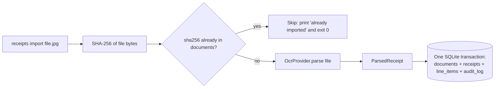
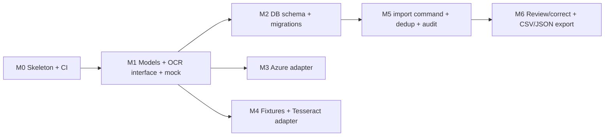

# Implementation Plan: OCR Receipt Import

This is the starting plan for the first feature of the Expense & Receipt Tracker. You feed it a photo or PDF of a receipt, and it gets a structured receipt row in your local ledger. The plan covers how the feature fits together, how the repo will be laid out, and how several contributors can get set up and work at the same time without blocking each other.

> **Status:** proposal. Nothing below is built yet. If you disagree with a decision, open an issue or comment on the PR that changes this doc.

---

## 1. Planning steps

Before writing code, the team works through five planning steps in order. Each step produces something concrete, and most of them are already drafted in this doc. Treat the drafts as proposals: discuss them in issues or on the PR, then tick the box once the team agrees.

| Step | Question it answers | Output | Status |
|---|---|---|---|
| 1. Define the project scope | What are we building, and what are we *not* building? | [§2 Goal and scope](#2-goal-and-scope) | Drafted |
| 2. Clarify requirements | What exactly must it do, and how well? | [§1.2](#12-clarify-requirements) requirement list | Drafted |
| 3. Define the MVP | What is the smallest version that's useful end to end? | [§1.3](#13-define-the-mvp) MVP definition | Drafted |
| 4. Choose a tech stack | Which language, database, libraries and services? | [§1.4](#14-choose-a-tech-stack) stack table | Drafted |
| 5. Create an implementation plan | Who builds what, in what order? | This doc + GitHub issues for each milestone | In progress |

### 1.1 Define the project scope

- Write down the problem in one sentence: *turn receipt photos and PDFs into structured, de-duplicated rows in a local ledger.*
- Name the users: people tracking their own expenses, and contributors practicing idempotency, migrations and API integration.
- Agree on what's in and out of scope. The current proposal is in [§2](#2-goal-and-scope).

- [ ] Team agrees on §2.

### 1.2 Clarify requirements

**Functional requirements**

| ID | Requirement |
|---|---|
| FR1 | Import a receipt from a JPG, PNG or PDF file with `receipts import <file>`. |
| FR2 | Extract merchant, date, total, subtotal, tax, currency and line items. Any of these may be missing. |
| FR3 | Importing the same file again never creates a duplicate receipt. |
| FR4 | If the OCR call fails, nothing is saved and the import can be retried. |
| FR5 | List, show and edit receipts. Every import, edit and delete is recorded in an audit log. |
| FR6 | Export receipts to CSV and JSON. |

**Non-functional requirements**

| ID | Requirement |
|---|---|
| NFR1 | Works fully offline with the mock provider. No API keys are needed to develop or run tests. |
| NFR2 | All data stays on the user's machine in a local database file. |
| NFR3 | Money is exact: `Decimal` in code, decimal strings in the database. |
| NFR4 | No secrets or personal receipts are ever committed. |
| NFR5 | Runs on Python 3.12+ on Windows, macOS and Linux. |

Anything still undecided goes in [§12 Open questions](#12-open-questions).

- [ ] Team agrees on the requirement list, and each requirement maps to at least one milestone in [§10](#10-milestones-and-work-breakdown).

### 1.3 Define the MVP

The MVP is the smallest version a new user could actually use: **import a receipt, see it in the ledger, fix it, and export it.**

- **In the MVP:** milestones M0, M1, M2, M3, M5 and M6. That covers the mock and Azure providers, the SQLite ledger with dedup and audit log, `import`, `list`, `show`, `edit` and CSV/JSON export.
- **Nice to have:** M4 (extra fixtures and the Tesseract adapter).
- **After the MVP:** exchange-rate conversion, bank/transaction feed matching, and a desktop UI.

**The MVP is done when** a new contributor can clone the repo, run `make test` offline, import a sample receipt, see it in `receipts list`, correct a field with `receipts edit`, and export the ledger to CSV. Re-importing the same file must be a no-op.

- [ ] Team agrees on the MVP boundary.

### 1.4 Choose a tech stack

| Area | Choice | Why |
|---|---|---|
| Language | Python 3.12+ | Familiar to most contributors, good OCR SDKs, `sqlite3` built in |
| Database | SQLite (stdlib `sqlite3`) | Zero setup, single file. DuckDB is still an [open question](#12-open-questions). |
| OCR | Mock provider (default) + Azure AI Document Intelligence `prebuilt-receipt` | Mock keeps everyone unblocked; Azure has a free tier and a receipt-specific model |
| Optional OCR | Tesseract via `pytesseract` | Free, fully local alternative (M4) |
| CLI | Typer | Readable commands and auto-generated `--help` |
| Config | `python-dotenv` + `.env` | Keeps keys out of code and git |
| Testing | `pytest` | Standard and simple |
| Lint/format | `ruff` | One fast tool for both |
| Packaging | `pyproject.toml`, `pip install -e ".[dev]"` | Standard modern Python packaging |
| CI | GitHub Actions | Free for this repo, runs on every PR |
| Desktop UI | To be decided after the MVP | See [open questions](#12-open-questions) |

- [ ] Team agrees on the stack. Any change gets recorded here.

### 1.5 Create an implementation plan

This document is the implementation plan. It covers the architecture ([§3](#3-how-an-import-works)), repo layout ([§4](#4-proposed-repo-layout)), interfaces ([§5](#5-the-ocr-provider-interface)), schema ([§7](#7-local-database-v1-schema)), workflow ([§9](#9-team-workflow)) and milestones ([§10](#10-milestones-and-work-breakdown)).

To finish this step:

- [ ] Merge this plan.
- [ ] Open one GitHub issue per milestone task in §10, with labels and dependencies noted.
- [ ] Open one issue per open question in §12.
- [ ] Contributors claim M0 and M1 to get started.

---

## 2. Goal and scope

**In scope (this plan):**

- A command-line import: `receipts import <file>` takes a receipt image (JPG/PNG) or PDF.
- An OCR / document-parsing step behind a **pluggable provider interface**.
- A **mock provider** that works offline with no API keys. It is the default, so everyone can develop and run tests.
- One **real provider**: Azure AI Document Intelligence (`prebuilt-receipt` model).
- A local **SQLite** ledger with migrations, deduplication and an audit log.

**Out of scope for now (later milestones):**

- Exchange-rate API / historical currency conversion
- Bank or transaction feed matching
- Desktop GUI (the CLI comes first, the UI wraps it later)

---

## 3. How an import works



Key ideas:

- **The idempotency key is the file's SHA-256 hash.** Importing the same file twice never creates a duplicate receipt.
- **The OCR call happens before anything is written.** If the API call fails or times out, nothing is saved, so you can simply run the command again.
- **All writes for one receipt happen in a single transaction.** You never end up with a half-imported receipt.
- **Every change is logged** to `audit_log`: imports, manual corrections and deletions.

---

## 4. Proposed repo layout

```
.
├── README.md
├── pyproject.toml            # package metadata + dependencies
├── Makefile                  # make install / test / lint / import
├── .env.example              # copy to .env, never commit .env
├── .github/workflows/ci.yml  # runs tests on every PR (mock provider only)
├── docs/
│   └── implementation-plan.md
├── src/receipt_tracker/
│   ├── cli.py                # `receipts` command (import, list, show, export)
│   ├── models.py             # ParsedReceipt, LineItem dataclasses
│   ├── db.py                 # connection, migration runner, insert helpers
│   ├── migrations/
│   │   └── 0001_init.sql
│   └── ocr/
│       ├── __init__.py       # get_provider() factory, reads OCR_PROVIDER
│       ├── base.py           # OcrProvider protocol
│       ├── mock.py           # reads tests/fixtures JSON, no network
│       └── azure.py          # Azure Document Intelligence adapter
└── tests/
    ├── fixtures/receipts/
    │   ├── sample1.jpg
    │   ├── sample1.json      # expected ParsedReceipt for sample1.jpg
    │   └── azure_sample1_response.json  # recorded real API response
    ├── test_mock_provider.py
    ├── test_azure_adapter.py
    ├── test_db.py
    └── test_import.py
```

---

## 5. The OCR provider interface

Every OCR backend implements the same small interface, so the rest of the app never knows which one it's talking to.

```python
# src/receipt_tracker/models.py
@dataclass
class LineItem:
    description: str
    quantity: Decimal | None
    unit_price: Decimal | None
    amount: Decimal | None

@dataclass
class ParsedReceipt:
    merchant: str | None
    transaction_date: date | None
    total: Decimal | None
    subtotal: Decimal | None
    tax: Decimal | None
    currency: str | None          # ISO 4217, e.g. "USD"
    line_items: list[LineItem]
    confidence: float | None      # 0..1, provider's overall confidence
    provider: str                 # "mock", "azure", ...
    raw_json: str                 # provider's original response, for debugging

# src/receipt_tracker/ocr/base.py
class OcrProvider(Protocol):
    name: str
    def parse(self, path: Path) -> ParsedReceipt: ...
```

- Use `Decimal` for money, never `float`.
- Any field can be `None` because OCR isn't perfect. The user fixes gaps later (milestone M6).
- `get_provider()` in `ocr/__init__.py` returns the provider named by the `OCR_PROVIDER` env var (`mock` by default).

**Adding a new provider** (Tesseract, Google Document AI, AWS Textract, Mindee, ...):

1. Create `ocr/<name>.py` with a class that implements `OcrProvider`.
2. Map that provider's response into `ParsedReceipt`.
3. Register it in `get_provider()`.
4. Save one real response as `tests/fixtures/receipts/<name>_*_response.json` and write a test that maps it **without calling the network**.

---

## 6. Config and secrets

`.env.example` (committed):

```
OCR_PROVIDER=mock            # mock | azure
LEDGER_PATH=./ledger.db

# Only needed if OCR_PROVIDER=azure
AZURE_DOCINTEL_ENDPOINT=
AZURE_DOCINTEL_KEY=
```

Rules:

- `.env` and `*.db` are in `.gitignore`. **Never commit API keys** or paste them in issues, PRs or chat.
- You only need Azure credentials if you're working on or trying the Azure adapter. Everyone else uses `mock`.
- Each person uses **their own** free-tier Azure resource. We don't share keys.

---

## 7. Local database (v1 schema)

Migrations are plain numbered SQL files in `src/receipt_tracker/migrations/`. `db.py` applies any that aren't yet recorded in `schema_migrations`, in order. **Never edit a migration that has been merged.** Add a new numbered file instead.

| Table | Purpose | Key columns |
|---|---|---|
| `schema_migrations` | Which migrations have run | `version`, `applied_at` |
| `documents` | One row per imported file | `id`, `sha256` **UNIQUE**, `filename`, `imported_at` |
| `receipts` | Parsed receipt header | `id`, `document_id` → documents, `merchant`, `transaction_date`, `total`, `subtotal`, `tax`, `currency`, `provider`, `confidence`, `raw_json` |
| `line_items` | Items on a receipt | `id`, `receipt_id` → receipts, `description`, `quantity`, `unit_price`, `amount` |
| `audit_log` | Every change | `id`, `entity`, `entity_id`, `action` (import/update/delete), `before_json`, `after_json`, `at` |

Money columns are stored as TEXT holding the exact decimal string (e.g. `"12.34"`) to avoid floating-point drift.

---

## 8. Contributor setup

**Prerequisites:** Python 3.12+, git, and GitHub access to this repo.

```bash
git clone https://github.com/Kiwi-223/TI-Fall2026-expense-recipt-tracker.git
cd TI-Fall2026-expense-recipt-tracker
python3 -m venv .venv
source .venv/bin/activate          # Windows: .venv\Scripts\activate
make install                       # pip install -e ".[dev]"
cp .env.example .env               # leaves OCR_PROVIDER=mock
make test                          # all tests should pass offline
make import FILE=tests/fixtures/receipts/sample1.jpg
```

The last command should print the parsed receipt. Running it a second time should say the file was already imported.

> `make install`, `make test` and `make import` will exist once milestone **M0** is merged. Until then, start by picking up M0.

### Optional: try the real Azure provider

1. In the Azure portal, create a **Document Intelligence** resource. The free **F0** tier is enough.
2. Copy its **endpoint** and one **key** into your `.env`, and set `OCR_PROVIDER=azure`.
3. Run `make import FILE=path/to/your/receipt.jpg`.
4. If you want to add a new test fixture, save the raw response JSON. **Remove anything personal first**, such as card digits, names and addresses.

---

## 9. Team workflow

`main` is protected: every change goes through a pull request, needs **1 approval**, and can't be force-pushed or deleted.

1. **Pick an issue** (or open one) and assign yourself so nobody duplicates work.
2. **Branch** off the latest `main`: `feat/<short-name>`, `fix/<short-name>` or `docs/<short-name>`.
3. **Keep PRs small.** One milestone task per PR is ideal.
4. **Before opening a PR:** run `make test` (and `make lint` once it exists).
5. **Open the PR**, link the issue (`Closes #N`), and ask a teammate to review.
6. **CI** (GitHub Actions) runs the test suite with `OCR_PROVIDER=mock`. It needs no secrets, so it works on PRs from forks too.
7. After approval, **squash-merge** and delete the branch.

---

## 10. Milestones and work breakdown

Each bullet below should become a GitHub issue. Owners are blank on purpose, so claim one!



| # | Task | Depends on | Can run in parallel with | Owner |
|---|---|---|---|---|
| **M0** | Project skeleton: `pyproject.toml`, `Makefile` (install/test/lint/import), `.gitignore`, `.env.example`, empty package, `ci.yml` running pytest | — | — | |
| **M1** | `models.py` (`ParsedReceipt`, `LineItem`), `ocr/base.py`, `ocr/__init__.py` factory, `ocr/mock.py`, first fixture (`sample1.jpg` + `sample1.json`) + tests | M0 | — | |
| **M2** | `db.py` migration runner, `0001_init.sql`, insert helpers, tests using a temp DB | M1 | M3, M4 | |
| **M3** | `ocr/azure.py` adapter using `azure-ai-documentintelligence` + `prebuilt-receipt`; mapping test against a recorded response (no network in CI) | M1 | M2, M4 | |
| **M4** | 3–5 more varied fixtures (different stores, currencies, a PDF), plus an optional `ocr/tesseract.py` adapter | M1 | M2, M3 | |
| **M5** | `receipts import` CLI: hash → dedup → parse → one transaction → audit log. Tests: re-import is a no-op, an OCR failure writes nothing | M1, M2 | M3, M4 | |
| **M6** | `receipts list/show/edit` (edits write to `audit_log`) and `receipts export --format csv\|json` | M5 | — | |
| Later | Exchange-rate API (historical rate by `transaction_date`), bank/transaction feed matching, desktop UI | M5+ | — | |

**Parallelism in practice:** M0 → M1 should be done by one or two people quickly, since they unblock everything else. After M1 merges, up to three people can work on M2, M3 and M4 at the same time because they touch different files.

---

## 11. Testing and definition of done

A task is done when:

- [ ] Its tests pass locally and in CI **with the mock provider and no network access**.
- [ ] New behavior has at least one test. Bugs get a test that fails before the fix.
- [ ] Money uses `Decimal`, and dates are ISO `YYYY-MM-DD`.
- [ ] No secrets, personal receipts or `.db` files are committed.
- [ ] The README or this doc is updated if setup steps changed.

Must-have tests for the import feature:

- Importing the same file twice → exactly one `documents` row and one `receipts` row.
- The OCR provider raises an error → zero new rows, and the command exits non-zero with a clear message.
- The Azure mapping turns a recorded response into the expected `ParsedReceipt`.
- Migrations run on a fresh DB and are a no-op when run again.

---

## 12. Open questions

Decide these as a team. Open an issue for each one and link it here once it's decided.

1. **SQLite vs DuckDB:** this plan assumes SQLite (built into Python, simplest). DuckDB is nicer for reports and exports.
2. **Desktop UI toolkit:** Textual (terminal UI), Tkinter, or a small local web UI?
3. **Storing receipt images:** copy each file into an app folder, or store only its path and hash?
4. **Low-confidence handling:** should receipts below a confidence threshold be flagged "needs review" automatically?
