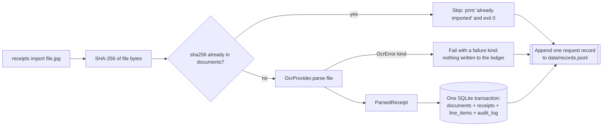
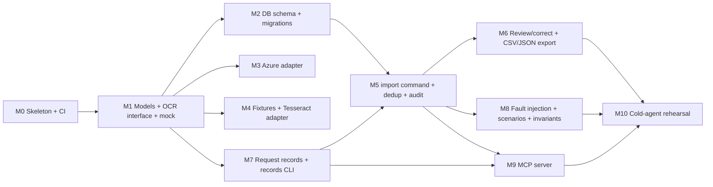

# Implementation Plan: OCR Receipt Import

This is the starting plan for the first feature of the Expense & Receipt Tracker. You feed it a photo or PDF of a receipt, and it gets a structured receipt row in your local ledger. The plan covers how the feature fits together, how the repo will be laid out, and how several contributors can get set up and work at the same time without blocking each other.

> **Status:** proposal. Nothing below is built yet. If you disagree with a decision, open an issue or comment on the PR that changes this doc.

---

## 1. Planning steps

Before writing code, the team works through five planning steps in order. Each step produces something concrete, and most of them are already drafted in this doc. Treat the drafts as proposals: discuss them in issues or on the PR, then tick the box once the team agrees.

| Step | Question it answers | Output | Status |
|---|---|---|---|
| 1. Define the project scope | What are we building, and what are we *not* building? | [§2 Goal and scope](#2-goal-and-scope) | Drafted |
| 2. Clarify requirements | What exactly must it do, and how well? | [§1.2](#12-clarify-requirements) requirement list | Drafted |
| 3. Define the MVP | What is the smallest version that's useful end to end? | [§1.3](#13-define-the-mvp) MVP definition | Drafted |
| 4. Choose a tech stack | Which language, database, libraries and services? | [§1.4](#14-choose-a-tech-stack) stack table | Drafted |
| 5. Create an implementation plan | Who builds what, in what order? | This doc + GitHub issues for each milestone | In progress |

### 1.1 Define the project scope

- Write down the problem in one sentence: *turn receipt photos and PDFs into structured, de-duplicated rows in a local ledger.*
- Name the users: people tracking their own expenses, and contributors practicing idempotency, migrations and API integration.
- Agree on what's in and out of scope. The current proposal is in [§2](#2-goal-and-scope).

- [ ] Team agrees on §2.

### 1.2 Clarify requirements

**Functional requirements**

| ID | Requirement |
|---|---|
| FR1 | Import a receipt from a JPG, PNG or PDF file with `receipts import <file>`. |
| FR2 | Extract merchant, date, total, subtotal, tax, currency and line items. Any of these may be missing. |
| FR3 | Importing the same file again never creates a duplicate receipt. |
| FR4 | If the OCR call fails, nothing is saved and the import can be retried. |
| FR5 | List, show and edit receipts. Every import, edit and delete is recorded in an audit log. |
| FR6 | Export receipts to CSV and JSON. |

**Non-functional requirements**

| ID | Requirement |
|---|---|
| NFR1 | Works fully offline with the mock provider. No API keys are needed to develop or run tests. |
| NFR2 | All data stays on the user's machine in a local database file. |
| NFR3 | Money is exact: `Decimal` in code, decimal strings in the database. |
| NFR4 | No secrets or personal receipts are ever committed. |
| NFR5 | Runs on Python 3.12+ on Windows, macOS and Linux. |

**Reliability and agent-readiness requirements**

These come from the TI26 program's required outcomes, adapted to this project. They're judged by a **cold-agent test**: a fresh AI agent with no context gets a one-line bug report and must find the root cause using only what the repo provides. [§13](#13-agent-readiness-requirements-cold-agent-test) explains each one in detail.

| ID | Requirement |
|---|---|
| RQ0 | It runs, and onboarding is written down in `AGENTS.md` for a reader with zero context. |
| RQ1 | Every command (import, edit, delete, export) leaves a persisted, machine-readable record you can query later. |
| RQ2 | Failures have names: every way the system can fail maps to one stable failure-kind id. |
| RQ3 | The OCR API (and later the exchange-rate API) can fail **on demand, reproducibly**, and nothing gets corrupted when it does. |
| RQ4 | An agent can ask the system questions through tools (an MCP server), without grepping raw files. |
| RQ5 | One command (`make test`) proves it works, including the failure paths. |
| RQ6 | The agent has boundaries enforced by checked-in configuration, not good intentions. |
| RQ7 | `AI_NOTES.md` honestly logs where the AI was confidently wrong and how we caught it. |

Anything still undecided goes in [§12 Open questions](#12-open-questions).

- [ ] Team agrees on the requirement list, and each requirement maps to at least one milestone in [§10](#10-milestones-and-work-breakdown).

### 1.3 Define the MVP

The MVP is the smallest version a new user could actually use: **import a receipt, see it in the ledger, fix it, and export it.**

- **In the MVP:** milestones M0, M1, M2, M3, M5 and M6. That covers the mock and Azure providers, the SQLite ledger with dedup and audit log, `import`, `list`, `show`, `edit` and CSV/JSON export.
- **Nice to have:** M4 (extra fixtures and the Tesseract adapter).
- **After the MVP:** exchange-rate conversion, bank/transaction feed matching, and a desktop UI.

- **Also in the MVP:** the "built-in from day one" parts of the agent-readiness requirements: `AGENTS.md`, failure kinds, request records and agent config (M0, M1, M7). They're cheap to add early and painful to retrofit. Fault injection, the MCP server and the cold-agent rehearsal (M8–M10) come right after.

**The MVP is done when** a new contributor can clone the repo, run `make test` offline, import a sample receipt, see it in `receipts list`, correct a field with `receipts edit`, and export the ledger to CSV. Re-importing the same file must be a no-op, and `make records ARGS="recent"` must show a record for each of those commands.

- [ ] Team agrees on the MVP boundary.

### 1.4 Choose a tech stack

| Area | Choice | Why |
|---|---|---|
| Language | Python 3.12+ | Familiar to most contributors, good OCR SDKs, `sqlite3` built in |
| Database | SQLite (stdlib `sqlite3`) | Zero setup, single file. DuckDB is still an [open question](#12-open-questions). |
| OCR | Mock provider (default) + Azure AI Document Intelligence `prebuilt-receipt` | Mock keeps everyone unblocked; Azure has a free tier and a receipt-specific model |
| Optional OCR | Tesseract via `pytesseract` | Free, fully local alternative (M4) |
| CLI | Typer | Readable commands and auto-generated `--help` |
| Config | `python-dotenv` + `.env` | Keeps keys out of code and git |
| Testing | `pytest` | Standard and simple |
| Lint/format | `ruff` | One fast tool for both |
| Packaging | `pyproject.toml`, `pip install -e ".[dev]"` | Standard modern Python packaging |
| CI | GitHub Actions | Free for this repo, runs on every PR |
| Request records | Append-only JSON Lines file (`data/records.jsonl`) | Survives restarts and DB failures, easy to query with the `records` CLI and MCP tools |
| Agent tools | MCP server using the official `mcp` Python SDK | Lets agents query records and run tests through tools ([RQ4](#rq4-an-agent-can-ask-the-system-questions)) |
| Agent config | Claude Code `.claude/settings.json` + `.mcp.json`, checked in | Permissions and sandbox enforced by config ([RQ6](#rq6-the-agent-has-boundaries)) |
| Desktop UI | To be decided after the MVP | See [open questions](#12-open-questions) |

- [ ] Team agrees on the stack. Any change gets recorded here.

### 1.5 Create an implementation plan

This document is the implementation plan. It covers the architecture ([§3](#3-how-an-import-works)), repo layout ([§4](#4-proposed-repo-layout)), interfaces ([§5](#5-the-ocr-provider-interface)), schema ([§7](#7-local-database-v1-schema)), workflow ([§9](#9-team-workflow)) and milestones ([§10](#10-milestones-and-work-breakdown)).

To finish this step:

- [ ] Merge this plan.
- [ ] Open one GitHub issue per milestone task in §10, with labels and dependencies noted.
- [ ] Open one issue per open question in §12.
- [ ] Contributors claim M0 and M1 to get started.

---

## 2. Goal and scope

**In scope (this plan):**

- A command-line import: `receipts import <file>` takes a receipt image (JPG/PNG) or PDF.
- An OCR / document-parsing step behind a **pluggable provider interface**.
- A **mock provider** that works offline with no API keys. It is the default, so everyone can develop and run tests.
- One **real provider**: Azure AI Document Intelligence (`prebuilt-receipt` model).
- A local **SQLite** ledger with migrations, deduplication and an audit log.
- **Debuggability for agents:** request records, named failure kinds, reproducible OCR faults, an MCP server and checked-in agent permissions ([§13](#13-agent-readiness-requirements-cold-agent-test)).

**Out of scope for now (later milestones):**

- Exchange-rate API / historical currency conversion
- Bank or transaction feed matching
- Desktop GUI (the CLI comes first, the UI wraps it later)

---

## 3. How an import works



Key ideas:

- **The idempotency key is the file's SHA-256 hash.** Importing the same file twice never creates a duplicate receipt.
- **The OCR call happens before anything is written.** If the API call fails or times out, nothing is saved, so you can simply run the command again.
- **All writes for one receipt happen in a single transaction.** You never end up with a half-imported receipt.
- **Every change is logged** to `audit_log`: imports, manual corrections and deletions.
- **The `documents` row is written only in the success transaction.** A failed import leaves no trace in the ledger, so a retry isn't wrongly skipped as "already imported".
- **Every command ends by appending one request record**, whether it succeeded, was skipped or failed ([RQ1](#rq1-every-command-leaves-a-record-you-can-query-later)). Failures carry a stable failure kind ([RQ2](#rq2-failures-have-names)).

---

## 4. Proposed repo layout

```
.
├── README.md
├── AGENTS.md                 # onboarding for humans + agents with zero context (RQ0)
├── CLAUDE.md                 # one line: @AGENTS.md (so Claude Code loads it)
├── AI_NOTES.md               # where the AI was confidently wrong (RQ7)
├── pyproject.toml            # package metadata + dependencies
├── Makefile                  # make install / test / lint / import / records / scenario / reset-local
├── .env.example              # copy to .env, never commit .env
├── .mcp.json                 # registers the MCP server for agents (RQ4)
├── .claude/settings.json     # agent permissions + sandbox (RQ6)
├── .github/workflows/ci.yml  # runs tests on every PR (mock provider only)
├── data/                     # gitignored: records.jsonl, scenario runs
├── docs/
│   └── implementation-plan.md
├── scripts/
│   ├── scenarios.py          # `make scenario NAME=...`: realistic runs on an isolated ledger (RQ3)
│   └── reset_local.py        # backs up and resets local state, deletes nothing (RQ6)
├── src/receipt_tracker/
│   ├── cli.py                # `receipts` command (import, list, show, edit, export)
│   ├── models.py             # ParsedReceipt, LineItem dataclasses
│   ├── failures.py           # FailureKind enum: the fixed set of failure ids (RQ2)
│   ├── records.py            # writes one request record per command (RQ1)
│   ├── records_query.py      # `make records ARGS=...` CLI over the records (RQ1)
│   ├── invariants.py         # ledger consistency checks (RQ3)
│   ├── mcp_server.py         # agent tools over records, ledger and tests (RQ4)
│   ├── db.py                 # connection, migration runner, insert helpers
│   ├── migrations/
│   │   └── 0001_init.sql
│   └── ocr/
│       ├── __init__.py       # get_provider() factory, reads OCR_PROVIDER
│       ├── base.py           # OcrProvider protocol + OcrError(kind)
│       ├── mock.py           # reads tests/fixtures JSON, no network, injects faults (OCR_FAULT)
│       └── azure.py          # Azure Document Intelligence adapter
└── tests/
    ├── fixtures/receipts/
    │   ├── sample1.jpg
    │   ├── sample1.json      # expected ParsedReceipt for sample1.jpg
    │   └── azure_sample1_response.json  # recorded real API response
    ├── test_mock_provider.py
    ├── test_azure_adapter.py
    ├── test_db.py
    ├── test_import.py
    ├── test_failure_kinds.py # every FailureKind is triggered by a real command
    ├── test_faults.py        # every OCR fault leaves the ledger consistent
    └── test_records.py
```

---

## 5. The OCR provider interface

Every OCR backend implements the same small interface, so the rest of the app never knows which one it's talking to.

```python
# src/receipt_tracker/models.py
@dataclass
class LineItem:
    description: str
    quantity: Decimal | None
    unit_price: Decimal | None
    amount: Decimal | None

@dataclass
class ParsedReceipt:
    merchant: str | None
    transaction_date: date | None
    total: Decimal | None
    subtotal: Decimal | None
    tax: Decimal | None
    currency: str | None          # ISO 4217, e.g. "USD"
    line_items: list[LineItem]
    confidence: float | None      # 0..1, provider's overall confidence
    provider: str                 # "mock", "azure", ...
    raw_json: str                 # provider's original response, for debugging

# src/receipt_tracker/ocr/base.py
class OcrProvider(Protocol):
    name: str
    def parse(self, path: Path) -> ParsedReceipt: ...
```

- Use `Decimal` for money, never `float`.
- Any field can be `None` because OCR isn't perfect. The user fixes gaps later (milestone M6).
- `get_provider()` in `ocr/__init__.py` returns the provider named by the `OCR_PROVIDER` env var (`mock` by default).
- A provider that fails raises `OcrError(kind)`, where `kind` is a `FailureKind` such as `ocr_timeout` or `ocr_auth_failed` ([RQ2](#rq2-failures-have-names)). Adapters must translate SDK/HTTP errors into these kinds and never let a raw SDK exception escape.

**Adding a new provider** (Tesseract, Google Document AI, AWS Textract, Mindee, ...):

1. Create `ocr/<name>.py` with a class that implements `OcrProvider`.
2. Map that provider's response into `ParsedReceipt`.
3. Register it in `get_provider()`.
4. Save one real response as `tests/fixtures/receipts/<name>_*_response.json` and write a test that maps it **without calling the network**.
5. Map each of its error responses to a `FailureKind`, and add a test for each mapping.

---

## 6. Config and secrets

`.env.example` (committed):

```
OCR_PROVIDER=mock            # mock | azure
LEDGER_PATH=./ledger.db
RECORDS_PATH=./data/records.jsonl

# Mock-provider fault injection (RQ3). Leave empty for normal runs.
OCR_FAULT=                   # timeout | auth_failed | rate_limited | unavailable | bad_response | low_confidence | random
OCR_FAULT_SEED=              # with OCR_FAULT=random: same seed -> same sequence of faults

# Only needed if OCR_PROVIDER=azure
AZURE_DOCINTEL_ENDPOINT=
AZURE_DOCINTEL_KEY=
```

Rules:

- `.env` and `*.db` are in `.gitignore`. **Never commit API keys** or paste them in issues, PRs or chat.
- You only need Azure credentials if you're working on or trying the Azure adapter. Everyone else uses `mock`.
- Each person uses **their own** free-tier Azure resource. We don't share keys.

---

## 7. Local database (v1 schema)

Migrations are plain numbered SQL files in `src/receipt_tracker/migrations/`. `db.py` applies any that aren't yet recorded in `schema_migrations`, in order. **Never edit a migration that has been merged.** Add a new numbered file instead.

| Table | Purpose | Key columns |
|---|---|---|
| `schema_migrations` | Which migrations have run | `version`, `applied_at` |
| `documents` | One row per imported file | `id`, `sha256` **UNIQUE**, `filename`, `imported_at` |
| `receipts` | Parsed receipt header | `id`, `document_id` → documents, `merchant`, `transaction_date`, `total`, `subtotal`, `tax`, `currency`, `provider`, `confidence`, `raw_json` |
| `line_items` | Items on a receipt | `id`, `receipt_id` → receipts, `description`, `quantity`, `unit_price`, `amount` |
| `audit_log` | Every change | `id`, `request_id` (links to the request record), `entity`, `entity_id`, `action` (import/update/delete), `before_json`, `after_json`, `at` |

Request records live in `data/records.jsonl`, not in the ledger, so they still get written when the ledger itself is the thing failing. The `request_id` column joins the two.

Money columns are stored as TEXT holding the exact decimal string (e.g. `"12.34"`) to avoid floating-point drift.

---

## 8. Contributor setup

**Prerequisites:** Python 3.12+, git, and GitHub access to this repo.

```bash
git clone https://github.com/Kiwi-223/TI-Fall2026-expense-recipt-tracker.git
cd TI-Fall2026-expense-recipt-tracker
python3 -m venv .venv
source .venv/bin/activate          # Windows: .venv\Scripts\activate
make install                       # pip install -e ".[dev]"
cp .env.example .env               # leaves OCR_PROVIDER=mock
make test                          # all tests should pass offline
make import FILE=tests/fixtures/receipts/sample1.jpg
```

The last command should print the parsed receipt. Running it a second time should say the file was already imported. To see what the system recorded about both runs:

```bash
make records ARGS="recent"         # one line per command: outcome, failure kind, receipt id
make scenario NAME=all             # optional: replay every fault scenario on an isolated ledger
```

**Using an AI agent?** Claude Code picks up `CLAUDE.md`, `.claude/settings.json` and `.mcp.json` automatically. Don't run it with `--dangerously-skip-permissions`; the checked-in config is the boundary ([RQ6](#rq6-the-agent-has-boundaries)).

> `make install`, `make test` and `make import` will exist once milestone **M0** is merged; `make records` once **M7** is, and `make scenario` once **M8** is. Until then, start by picking up M0.

### Optional: try the real Azure provider

1. In the Azure portal, create a **Document Intelligence** resource. The free **F0** tier is enough.
2. Copy its **endpoint** and one **key** into your `.env`, and set `OCR_PROVIDER=azure`.
3. Run `make import FILE=path/to/your/receipt.jpg`.
4. If you want to add a new test fixture, save the raw response JSON. **Remove anything personal first**, such as card digits, names and addresses.

---

## 9. Team workflow

`main` is protected: every change goes through a pull request (no direct pushes), and `main` can't be force-pushed or deleted. A PR asks for **1 approval**, but anyone with Write access or higher can skip that and merge their own PR by ticking **"Merge without waiting for requirements to be met"**. Please still ask for a review when your change touches shared code: the schema, the `OcrProvider` interface or CI.

1. **Pick an issue** (or open one) and assign yourself so nobody duplicates work.
2. **Branch** off the latest `main`: `feat/<short-name>`, `fix/<short-name>` or `docs/<short-name>`.
3. **Keep PRs small.** One milestone task per PR is ideal.
4. **Before opening a PR:** run `make test` (and `make lint` once it exists).
5. **Open the PR**, link the issue (`Closes #N`), and ask a teammate to review.
6. **CI** (GitHub Actions) runs the test suite with `OCR_PROVIDER=mock`. It needs no secrets, so it works on PRs from forks too.
7. Once it's approved (or you've chosen to bypass review), **squash-merge** and delete the branch.

---

## 10. Milestones and work breakdown

Each bullet below should become a GitHub issue. Owners are blank on purpose, so claim one!



| # | Task | Depends on | Can run in parallel with | Owner |
|---|---|---|---|---|
| **M0** | Project skeleton: `pyproject.toml`, `Makefile` (install/test/lint/import), `.gitignore` (incl. `data/`, `*.db`, `.env`), `.env.example`, empty package, `ci.yml` running pytest. **Plus** a starter `.claude/settings.json` matching `AGENTS.md` "Agent boundaries", `make check-settings`, an empty `AI_NOTES.md`, and updating `AGENTS.md` to drop the M0 tags (RQ0, RQ6, RQ7) | — | — | |
| **M1** | `models.py` (`ParsedReceipt`, `LineItem`), `failures.py` (`FailureKind`), `ocr/base.py` (`OcrProvider`, `OcrError`), `ocr/__init__.py` factory, `ocr/mock.py`, first fixture (`sample1.jpg` + `sample1.json`) + tests | M0 | — | |
| **M2** | `db.py` migration runner, `0001_init.sql`, insert helpers, tests using a temp DB | M1 | M3, M4, M7 | |
| **M3** | `ocr/azure.py` adapter using `azure-ai-documentintelligence` + `prebuilt-receipt`; mapping test against a recorded response, and every Azure error mapped to a `FailureKind` (no network in CI) | M1 | M2, M4, M7 | |
| **M4** | 3–5 more varied fixtures (different stores, currencies, a PDF), plus an optional `ocr/tesseract.py` adapter | M1 | M2, M3, M7 | |
| **M7** | `records.py` (one record per command, see [RQ1](#rq1-every-command-leaves-a-record-you-can-query-later)) and `records_query.py` + `make records` (`recent`, `recent-failures`, `failure-counts --since 1h`, `request <id>`, `receipt <id>`, `file <sha256>`) | M1 | M2, M3, M4 | |
| **M5** | `receipts import` CLI: hash → dedup → parse → one transaction → audit log → request record. Tests: re-import is a no-op, an OCR failure writes nothing to the ledger but does write a record with its failure kind | M1, M2, M7 | M3, M4 | |
| **M6** | `receipts list/show/edit/delete` (each writes `audit_log` + a request record) and `receipts export --format csv\|json` | M5 | M8, M9 | |
| **M8** | Fault injection in the mock (`OCR_FAULT`, `OCR_FAULT_SEED`, plus a "crash before commit" fault), `invariants.py`, `make scenario NAME=...`, `make reset-local`, and `tests/test_faults.py` proving every fault leaves the ledger consistent ([RQ3](#rq3-the-ocr-api-can-fail-and-nothing-gets-corrupted)) | M5 | M6, M9 | |
| **M9** | `mcp_server.py` + `.mcp.json`: read-only query tools plus `run_tests` ([RQ4](#rq4-an-agent-can-ask-the-system-questions)); add the tools to `.claude/settings.json` | M5, M7 | M6, M8 | |
| **M10** | Cold-agent rehearsal: someone plants a bug, a fresh agent session gets only a symptom, and we fix whatever it was missing. Finish `AGENTS.md` "Debugging a symptom" and the "Agent boundaries" section | M6, M8, M9 | — | |
| Ongoing | Add an `AI_NOTES.md` entry in the PR where an AI mistake is caught (RQ7). Update `AGENTS.md` in any PR that changes setup, commands, layout or data locations (RQ0) | — | everything | everyone |
| Later | Exchange-rate API (historical rate by `transaction_date`, with its own failure kinds and faults), bank/transaction feed matching, desktop UI | M5+ | — | |

**Parallelism in practice:** M0 → M1 should be done by one or two people quickly, since they unblock everything else. After M1 merges, up to four people can work on M2, M3, M4 and M7 at the same time because they touch different files. After M5, M6, M8 and M9 can also run in parallel.

---

## 11. Testing and definition of done

A task is done when:

- [ ] Its tests pass locally and in CI **with the mock provider and no network access**.
- [ ] New behavior has at least one test. Bugs get a test that fails before the fix.
- [ ] Money uses `Decimal`, and dates are ISO `YYYY-MM-DD`.
- [ ] No secrets, personal receipts or `.db` files are committed.
- [ ] The README or this doc is updated if setup steps changed.
- [ ] `AGENTS.md` is updated if setup, commands, layout or data locations changed.
- [ ] Any new way to fail has a `FailureKind` and a test that triggers it through a real command.
- [ ] Any new command writes a request record.

Must-have tests for the import feature:

- Importing the same file twice → exactly one `documents` row and one `receipts` row.
- The OCR provider raises an error → zero new rows, and the command exits non-zero with a clear message **and its failure kind**.
- After a failed import, re-running the same file without the fault imports it normally (not "already imported").
- Every `OCR_FAULT` value, and a crash just before commit → the invariants in [RQ3](#rq3-the-ocr-api-can-fail-and-nothing-gets-corrupted) still hold.
- The same `OCR_FAULT_SEED` produces the same sequence of faults.
- Every command writes exactly one request record, and the records are still there after the process restarts.
- Every `FailureKind` is triggered by at least one test (the test fails if a kind is never triggered).
- The Azure mapping turns a recorded response into the expected `ParsedReceipt`.
- Migrations run on a fresh DB and are a no-op when run again.

---

## 12. Open questions

Decide these as a team. Open an issue for each one and link it here once it's decided.

1. **SQLite vs DuckDB:** this plan assumes SQLite (built into Python, simplest). DuckDB is nicer for reports and exports.
2. **Desktop UI toolkit:** Textual (terminal UI), Tkinter, or a small local web UI?
3. **Storing receipt images:** copy each file into an app folder, or store only its path and hash?
4. **Low-confidence handling:** should receipts below a confidence threshold be flagged "needs review" automatically?
5. **Which agent tool:** this plan assumes Claude Code for the checked-in config (RQ6). If contributors use other agents (Cursor, Copilot, Codex), do we add their config too, or document Claude Code as the supported one?
6. **Records retention:** keep `data/records.jsonl` forever, or rotate it (e.g. monthly files)?

---

## 13. Agent-readiness requirements (cold-agent test)

These adapt the TI26 required outcomes to this project. Where the original brief talks about scooters and payments, this project's equivalents are **receipts and imports** and the **OCR API** (later also the exchange-rate API).

### The acceptance test: the cold agent

1. Someone plants a bug in the repo that the rest of the team hasn't seen.
2. A **fresh** agent session starts in the repo, with no chat history and no hints. It gets only a one-sentence symptom, the kind a user would file. For example:
   - *"I imported the same receipt twice and now it shows up twice in my list."*
   - *"My grocery receipt was $12.34 but the ledger says $1,234.00."*
   - *"The import timed out, and now when I retry it says 'already imported' but the receipt isn't in my list."*
3. The agent can use anything the repo provides: docs, scripts, tests, MCP tools and the recorded data.
4. It passes if, within the time limit, it:
   - names the root cause,
   - backs that up with **evidence from what the system recorded** (request records, audit log, ledger state), not just a guess from reading code, and
   - writes a failing test that reproduces the bug.

Nobody can help it once it starts. If it gets lost, ask what it was missing, then add that to `AGENTS.md`, a tool or a record.

### RQ0. It runs, and onboarding is written down

- `AGENTS.md` (with `CLAUDE.md` containing just `@AGENTS.md`) tells the next agent how to **set up, run, test, find the recorded data, and query it**. Write it for a reader with zero context.
- It starts with a **"Debugging a symptom (start here)"** section: check `git status`/`git diff` for a planted change → `make test` → `make scenario` to reproduce → query records → write a failing test from a template.
- A starter [`AGENTS.md`](../AGENTS.md) and [`CLAUDE.md`](../CLAUDE.md) already exist. They describe the planned system, with each piece tagged by the milestone that builds it, so a cold agent can tell what exists yet.
- **Milestones:** starter done; each milestone's PR updates it (removing that milestone's tags), and it's finished in M10.

### RQ1. Every command leaves a record you can query later

One JSON line per command in `data/records.jsonl` (append-only, so it survives restarts):

| Field | Example |
|---|---|
| `request_id` | `7f3c…` (or `scn-faults-003` in scenarios) |
| `command`, `args` | `import`, `{"file": "receipts/costco.jpg"}` |
| `started_at`, `ended_at` | ISO timestamps |
| `git_sha`, `git_dirty_paths` | which code ran (helps spot a planted change) |
| `file` | `{"path": …, "sha256": …, "size": …}` |
| `provider`, `fault` | `mock`, `timeout` (the fault that was injected, if any) |
| `decisions` | ordered steps: `hash ok`, `dedup new`, `ocr failed(ocr_timeout)`, `db_write rolled_back`, … |
| `receipt_before`, `receipt_after` | snapshots for edits and deletes |
| `outcome` | `imported` \| `skipped_duplicate` \| `updated` \| `deleted` \| `exported` \| `failed` |
| `failure_kind` | stable id from RQ2, or `null` |
| `receipt_id`, `document_id` | to follow one receipt end-to-end |

You can follow **one request** (`make records ARGS="request <id>"`), **one receipt** (`receipt <id>`) or **one file** (`file <sha256>`) end-to-end. `audit_log.request_id` links ledger changes back to the record that made them. **Milestone:** M7.

### RQ2. Failures have names

- `failures.py` defines `FailureKind`, a fixed set of stable ids. Examples: `file_not_found`, `unsupported_file_type`, `file_unreadable`, `ocr_not_configured`, `ocr_auth_failed`, `ocr_timeout`, `ocr_rate_limited`, `ocr_unavailable`, `ocr_bad_response`, `receipt_unparseable`, `validation_failed`, `receipt_not_found`, `db_error`, `migration_failed`, `export_failed`. Later: `fx_rate_unavailable`, `fx_timeout`.
- Every failed command prints its kind (and `--json` output carries `{"error": {"kind": …, "message": …}}`), exits non-zero, and writes it to the record's `failure_kind`.
- Once an id has shipped, it is never renamed or reused for a different meaning. A new failure mode gets a new id plus a test that triggers it.
- `make records ARGS="failure-counts --since 1h"` answers "how many of each kind in the last hour?" without parsing English. **Milestones:** M1 (enum), M5/M7 (wired in).

### RQ3. The OCR API can fail, and nothing gets corrupted

In the original brief this was payment. Here the external dependency is the OCR API (and later the exchange-rate API).

- **Failure on demand, reproducibly:** the mock provider reads `OCR_FAULT` (`timeout`, `auth_failed`, `rate_limited`, `unavailable`, `bad_response`, `low_confidence`) or `OCR_FAULT=random` with `OCR_FAULT_SEED`, which gives the same faults for the same seed. A fixture's JSON can also pin a fault to one file. A test-only `IMPORT_FAULT=crash_before_commit` simulates the process dying mid-import.
- **Invariants** (`invariants.py`, run by tests, `make scenario` and the MCP `check_invariants` tool):
  - every `receipts` row has exactly one `documents` row, and the other way round;
  - no `documents` row exists for a file whose last import failed, so a retry is never wrongly skipped;
  - every ledger change has an `audit_log` row whose `request_id` matches a record;
  - money columns parse as exact decimals; line items never reference a missing receipt.
- **Prove it:** `tests/test_faults.py` runs every fault and checks the invariants, and a seeded "fault soak" test runs many random imports. `make scenario NAME=faults` replays them on an isolated ledger in `data/scenarios/<name>/`, so the live ledger is never touched. **Milestone:** M8.

### RQ4. An agent can ask the system questions

`mcp_server.py`, registered in `.mcp.json`. It's a thin layer over the same functions the `records` CLI uses:

| Tool | Answers | Writes? |
|---|---|---|
| `recent_failures(since)` | What failed recently? | no |
| `failure_counts(since)` | How many of each kind? | no |
| `request_trace(request_id)` | Everything one command decided | no |
| `receipt_history(receipt_id \| sha256)` | What happened to this receipt or file? | no |
| `receipt_state(receipt_id)` | What's in the ledger now? | no |
| `check_invariants(scenario?)` | Is the ledger consistent? | no |
| `run_tests(args?)` | Run the test suite | runs pytest (asks first) |

Every read-only tool takes an optional `scenario` to read a `make scenario` run instead of the live data. The CLI (`make records ARGS=...`) stays as the fallback. **Milestone:** M9.

### RQ5. One command proves it works

`make test` runs the whole suite offline with the mock provider, and covers the failure paths, not just the happy path (see the must-have tests in [§11](#11-testing-and-definition-of-done)). CI runs the same command. **Milestones:** M0, then every PR.

### RQ6. The agent has boundaries

Enforced by a checked-in `.claude/settings.json` (and `.mcp.json`), with an **"Agent boundaries"** section in `AGENTS.md` explaining each choice:

| Concern | Our answer |
|---|---|
| **Blast radius** | The worst cases: deleting or corrupting someone's local `ledger.db` (personal financial data), leaking `.env` keys or personal receipts, spending Azure quota, or pushing to `main`. |
| **Permissions** | **Allow:** `make test/lint/records/scenario`, read-only `git` and `gh pr view/list/diff/create`, read-only MCP tools. **Ask:** `run_tests` via MCP, `gh pr merge` (agents open PRs, humans merge), editing `.claude/**`, `.github/**`, `.mcp.json` or merged migrations, `git reset --hard`, `git clean`. **Deny:** reading `.env`, `receipts/**` or `ledger.db`, `rm -rf`, `git push --force`/`--delete`, pushing to `main`, `gh pr merge --admin`, `gh api` calls to rulesets/branch protection, `gh repo delete`. |
| **Isolation** | Sandbox on, with a network allowlist (PyPI, GitHub). The Azure endpoint is **not** on it, so agents run with the mock and can't spend OCR quota. Work happens on a branch or git worktree, never on `main`. |
| **Reversibility** | Everything lands through PRs (`main` is protected). `make reset-local` moves the ledger and `data/` aside with a timestamp and deletes nothing. The audit log records `before`/`after` for every ledger change. |
| **Budget** | Headless runs go through a `make agent TASK=...` wrapper with turn, time and spend caps. The Azure F0 tier is free and throttles instead of billing. |

No one runs with `--dangerously-skip-permissions`; a `make check-settings` target validates the settings file. The full rule list is in `AGENTS.md` ["Agent boundaries"](../AGENTS.md#agent-boundaries), which `.claude/settings.json` must match. **Milestones:** M0 (starter config), M9 (MCP tools), M10 (finished section).

### RQ7. `AI_NOTES.md`: what the AI got wrong

A short, honest log of where an agent was **confidently wrong** and how we caught it (a test, a record, a review, a gut feeling). Each entry has: who/what was wrong, the confident claim, how it was caught (link the PR or test), what changed, and the lesson. Three good entries beat ten vague ones. Add an entry in the PR where the mistake is caught. **Milestone:** ongoing.
